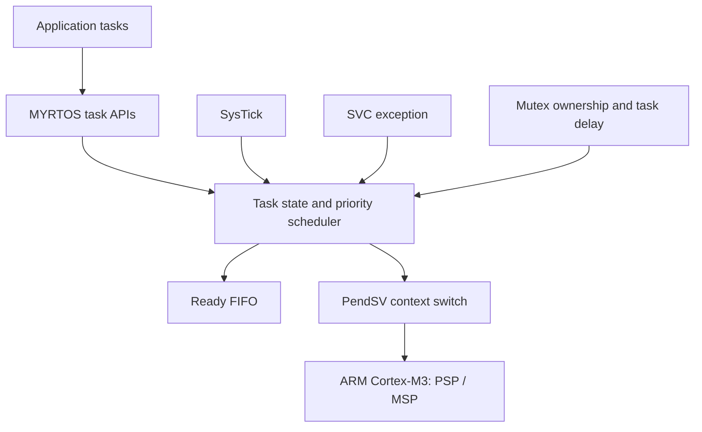

# MYRTOS — Educational RTOS Kernel for ARM Cortex-M3

**Author:** Mohamed Aldreamly  
**Target:** STM32F103C6 / ARM Cortex-M3  
**Language:** Embedded C, ARM inline assembly  
**Status:** Educational prototype; not production-ready.

MYRTOS is a custom bare-metal RTOS learning project exploring task stack initialization, priority scheduling, round-robin among equal-priority tasks, Cortex-M exception-based context switching, tick-driven delays, and basic mutex ownership.

> **Scope:** The code and debug captures are educational demonstrations. They are not evidence of real-time guarantees, functional safety, or production readiness.

## Explore the project

| Area | Location |
|---|---|
| Full STM32 project | [My_Own_RTOS_Full](My_Own_RTOS_Full/) |
| Kernel implementation | [MY_RTOS](My_Own_RTOS_Full/MY_RTOS/) |
| Application/demo | [Src/main.c](My_Own_RTOS_Full/Src/main.c) |
| Development snapshots | [SchedulerV1](My_Own_RTOS_SchedulerV1/) · [V2](My_Own_RTOS_SchedulerV2/) · [V3](My_Own_RTOS_SchedulerV3/) · [V4](My_Own_RTOS_SchedulerV4/) · [V5](My_Own_RTOS_SchedulerV5/) · [V6](My_Own_RTOS_SchedulerV6/) |

## Architecture

**Execution model:** application tasks execute in Thread mode using PSP; exception handlers execute in privileged Handler mode using MSP. SysTick drives scheduling, SVC handles selected kernel requests, and PendSV performs context switching.

## Implemented learning features

- Task descriptors and dedicated PSP stack regions with initial exception-frame values
- Priority ordering and a FIFO ready queue for equal-priority rotation
- SysTick-based scheduling and task-delay countdown
- Cortex-M3 SVC/PendSV exception handling and manual register-context handling
- Idle task containing `WFE`
- Basic mutex ownership with a single pending waiter

## Validation scenarios

The six scenarios below were explored using Keil debugging and Logic Analyzer captures. **The current `My_Own_RTOS_Full/Src/main.c` is one demonstration configuration, not a complete automated test suite.** Some scenarios require changes to task code or enabling commented lines.

| ID | Scenario | Intended observation |
|---|---|---|
| TC-01 | Stack initialization and equal-priority round robin | PSP initialization, startup, task alternation |
| TC-02 | Higher-priority activation | Higher-priority task becomes eligible and runs |
| TC-03 | Tick-based waiting and idle | Delayed tasks are suspended and later eligible; idle uses WFE |
| TC-04 | Cascaded priority activation | Multiple priority levels preempt and resume |
| TC-05 | Mutex contention | Higher-priority task waits on mutex held by lower-priority task |
| TC-06 | Opposite mutex acquisition order | Circular wait / deadlock demonstration |

See the engineering reports and annotated captures from the project portfolio for detailed evidence. These assets should be added under `docs/` only after verifying the final exported files.

## Known limitations / review findings

This is an experimental kernel with unresolved correctness and robustness concerns:

1. `MYRTOS_ReleaseMutex()` dereferences the new owner even when `NextTUser` is `NULL`.
2. The scheduler's `PnextTask` can be `NULL` before a `TaskState` access.
3. `PendSV_Handler` is marked `naked` but contains C statements and extended inline assembly; this needs architecture/compiler-safe restructuring.
4. No demonstrated priority-inheritance protocol or deadlock prevention.
5. Task-count bounds, empty ready queue cases, zero-delay behavior, stack alignment, and API ownership checks need dedicated tests.
6. Logic Analyzer LED toggles indicate task activity, not exact scheduling latency or worst-case execution time.

**Repository consistency note:** In the currently published full-project `Src/main.c`, the MUTEX2 acquisition calls are commented out. Therefore, that specific checked-in configuration does **not** reproduce the two-mutex deadlock without modification. Do not label it as a passing deadlock test.

## Build and reproduce

1. Open `My_Own_RTOS_Full` as an STM32CubeIDE project (it contains `.project`, `.cproject`, linker script and startup sources).
2. Verify the STM32F103C6 target, compiler configuration, clock tree and device support files.
3. Build and debug in a compatible STM32 environment.
4. For each test case, use the corresponding saved application configuration and capture task state / registers / traces.

**Build status:** No independent clean build or hardware run was performed as part of this documentation update.

## Development history

The `My_Own_RTOS_SchedulerV1`–`V6` folders are historical snapshots. Keep them as an archive rather than treating each as a separately verified release.

## Next steps

- Fix the identified pointer and exception-handler safety issues.
- Add reproducible, self-contained test-case sources and expected observations.
- Attach design and validation reports with verified image references.
- Add build instructions with exact toolchain versions and hardware/simulator details.
- Add a license only after choosing appropriate terms for original and third-party code.
